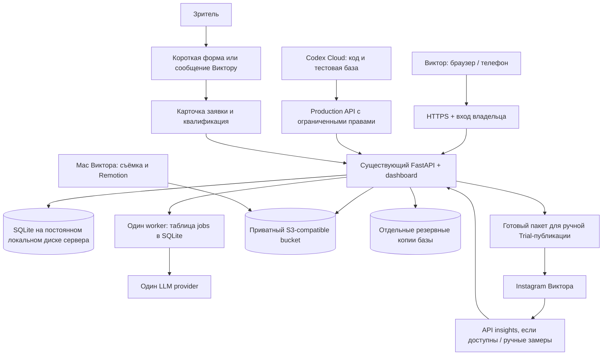

# BALI CONTENT OS: план Production V1

Дата аудита: 26 октября 2026. Базовая версия MVP: `8ba24ab456c45b89cf7f2d31dd962bce7f8c4185`, опубликована в GitHub `viktorwang85/meridian`, ветка `main`.

**Решение:** сохранить Python, FastAPI, SQLite, HTML dashboard и Remotion. Вынести единственную рабочую базу и постоянно работающий API на небольшой сервер с постоянным диском. Footage хранить в приватном объектном хранилище. Codex Cloud использовать для разработки и работы через защищённый API, а не как место эксплуатации системы. Первую ежедневную версию запустить с ручной Trial-публикацией; автоматизацию Meta включать только после проверки возможностей конкретного аккаунта.

Это результат аудита и план следующих изменений. В этом этапе реализация не менялась, серверы и хранилища не создавались, платные API и Instagram не вызывались. Фиксация MVP в GitHub сохраняет код, **но не рабочую SQLite-базу и footage**.

## 1. Что проверено и чего пока нет

Аудит выполнен по исходникам `app/core.py`, `app/content.py`, `app/web.py`, `app/dashboard.html`, `cli/main.py`, `scripts/bootstrap.py`, `render/src/Root.tsx`, тестам, lockfiles и документации.

| Область | Фактическое состояние | Минимальное изменение для ежедневной работы |
|---|---|---|
| База | `BALI_DB` или `data/bali.sqlite3`; файл исключён из Git. В рабочей базе 50 экспериментов, 41 artifact, 0 публикаций | Один production-файл на постоянном диске, резервные копии и API-доступ из Cloud tasks |
| Dashboard | Только GET `/` и `/api/state`; процесс на loopback:8000, без авторизации; изменения доступны через CLI | Постоянный HTTPS-сервис с входом и несколькими формами для основных действий |
| Footage | Индекс по абсолютному локальному пути; нет upload, связи asset→variant и переносимых ссылок | Приватный S3-compatible bucket и стабильные asset IDs; локальный путь оставить только кэшем |
| LLM | Только `LocalProvider`; prompt-файлы не являются интеграцией с моделью | Один реальный provider за существующим интерфейсом, проверка JSON, версии и лимит затрат |
| Publishing | Очередь/approve/record — локальный журнал, не отправка в Instagram. `trial=1` выставляется по умолчанию | Ручной Trial workflow с подтверждением фактического режима; затем отдельный проверенный Meta-адаптер |
| Метрики | CSV, последний накопительный snapshot; отсутствующие поля превращаются в 0 | Различать unknown и 0; provenance, возраст замера, метрики variant/publication; API — только для реально доступных показателей |
| Заявки | Агрегированные числа в metrics; нет карточек людей, формы и пути к депозиту | Небольшой leads ledger и короткая форма/ручной ввод с источником обращения |

### Выявленные проблемы, влияющие на ежедневный цикл

1. **P0 — отсутствие общего рабочего состояния.** Bootstrap новой базы создаёт 50 seed-записей, но не восстанавливает последующие решения, метрики и заявки. Снимок опубликованной облачной среды — исходное состояние новых задач, а не синхронизация изменений разных задач. Не следует считать Git push, environment publish или успешный bootstrap резервной копией актуальной работы.
2. **P0 — обход approval в статусах.** На временной копии базы подтверждено: обычная `experiment status` позволяет последовательно дойти до PUBLISHED без единой approved publication. Сам `publish record` проверяет approve, но правило не соблюдается на всех путях. До интеграции публикации статус должен выводиться из подтверждённого события публикации. Approve необходимо привязать к конкретной версии видео, caption и режиму Trial.
3. **P0 перед публикацией dashboard наружу — нет защиты API.** `/api/state` отдаёт все карточки и learnings. Простое переключение на `0.0.0.0` и открытие порта не создают постоянный безопасный продукт.
4. **P1 — статус не равен готовности.** Генерация шаблона и brief автоматически переводит эксперимент в READY_TO_SHOOT, хотя текст содержит незаполненный личный эпизод. Нужен явный редакторский approve и выбранная версия hook/script, а не только факт генерации.
5. **P1 — неполная цепочка медиа.** `variants.file_path` не связан с footage; нет проверенного результата экспорта, checksum, пропсов и версии рендера. Карточка/PNG в тесте не доказывают пригодность реального MP4 к публикации.
6. **P1 — искажение аналитики.** Нулевые значения вместо unavailable могут менять scores; суммирование вариантов скрывает победивший hook. `scores()` использует поля experiment, а не фактически опубликованной версии variant. Completion нельзя достоверно вывести из average watch time. Текущий score — эвристика, а не доказательство результата.
7. **P1 — нет измерения коммерческого результата.** Число qualified_leads без идентификаторов обращений не позволяет исключать повторы, менять квалификацию и объяснить происхождение заявки. Выручка в snapshots может быть задвоена между публикациями.
8. **P2 — эксплуатация не описана кодом.** Нет supervisor, health/readiness endpoints, миграций схемы, deployment/rollback и restore drill. Дневная очередь не учитывает сроки публикации и возраст метрик.

Проверки в рамках аудита: `PRAGMA quick_check` текущей базы → `ok`; SQLite backup на временный путь и чтение восстановленных 50 экспериментов → успешно; bootstrap отдельной пустой базы → 50 seed-записей; обход статуса воспроизведён только на временной копии. Рабочая база не изменена. Существующие семь тестов покрывают MVP-функции, но не восстановление после потери сервера, новую Cloud task, OAuth или реальную публикацию.

## 2. Минимальная архитектура

### Состав и границы

- Один небольшой Linux VPS/VM, например 2 vCPU и 4 GB RAM как стартовая оценка для API/worker без тяжёлого рендера. Это не benchmark; размер подтвердить нагрузкой и объёмом данных.
- FastAPI остаётся приложением; один API-процесс и один worker с короткими транзакциями. Caddy или эквивалент — HTTPS reverse proxy. Systemd или Docker Compose с restart policy — выбрать один способ при внедрении, не поддерживать два параллельно.
- SQLite — только на локальном persistent block volume этого сервера, вне checkout и контейнерного слоя. Предлагаемый путь: `/var/lib/bali-content-os/bali.sqlite3`, через уже существующий `BALI_DB`.
- Хранилище медиа — приватный S3-compatible bucket. Не превращать bucket в файловую систему для SQLite. Разделение raw/generated/proxies/backups; backups с отдельными правами и retention.
- Тяжёлый Remotion-рендер в V1 запускается Виктором на Mac по запросу; готовый MP4 загружается в систему. Это сохраняет существующий шаблон и не требует GPU/браузерного render-сервиса. Перенос рендера на worker — позже, если локальный шаг реально мешает.
- Никаких Kubernetes, Redis/Celery, Supabase, нового frontend framework или Postgres на первом шаге. Переход к Postgres нужен при нескольких экземплярах приложения/активных редакторах либо подтверждённой проблеме блокировок, а не для самого факта persistence.
- GitHub хранит код, seed и документацию. Ни production DB, ни footage, ни credentials, ни персональные данные гостей в Git не попадают.

## 3. Persistent database между Codex Cloud tasks

### Решение

Production DB принадлежит постоянному сервису. Codex-задача получает код из GitHub и отдельную тестовую базу, а актуальные рабочие данные читает через авторизованный API. Изменения production — через узкие явно разрешённые операции, с журналом и проверкой версии. Не копировать SQLite назад-вперёд между задачами; не пытаться сливать файлы баз.

### Минимальные изменения

1. Оставить `sqlite3`, текущие таблицы и `connect()`. В production явно задать `BALI_DB` вне репозитория. Отсутствие ожидаемой базы после первичного развёртывания должно останавливать readiness с ошибкой, а не молча создавать новую пустую рабочую систему.
2. Добавить нумерованные SQL migrations и schema_version. Bootstrap — только отдельная одноразовая команда инициализации; deploy/start не должны генерировать контент или повторно импортировать seed.
3. Вынести общие операции из CLI в тонкий service layer с существующей логикой и открыть их через API. CLI оставить локальным dev-инструментом; добавить remote mode только для необходимых рабочих операций. Production-записи никогда не выполняются SQL-командами из Cloud task.
4. Для правок карточек добавить `revision`; устаревшая правка получает conflict, а не затирает новую. Для создания и внешних действий — idempotency key. Добавить `audit_events` с актором, временем, объектом и типом операции.
5. Настроить WAL и busy timeout после проверки нагрузки. Транзакции короткие; LLM/сеть/рендер не должны держать транзакцию открытой. WAL сам по себе не создаёт persistence или backup.
6. Backup через SQLite online backup API (`Connection.backup()`), затем загрузка согласованной копии в отдельное защищённое хранилище. Не копировать только основной файл живой WAL-базы обычным `cp`. Начальная политика: каждый час, перед миграцией; хранить 48 почасовых и 30 ежедневных копий. Цели: RPO ≤1 часа, RTO ≤4 часов, подтвердить restore drill. При недоступном backup выдавать видимую ошибку.
7. Окружения отделены: dev DB в Cloud task, staging на отдельном файле/диске, production — один authoritative database. Синтетический seed допустим только в dev/staging. Production-токен Codex по умолчанию read-only, без публикации и чтения контактов гостей.

### Перенос существующей базы

На коротком окне остановить записи, сделать backup текущей базы, проверить целостность, записать counts/checksum и перенести копию на persistent volume. Сохранить все ID, родительские связи и artifacts. После миграций сравнить записи и открыть запись только на новом сервере. Старую копию оставить read-only; не допускать двух независимых production-баз. Нельзя заменять текущую базу просто новым seed на сервере.

### Приёмка

Создать карточку через рабочий интерфейс, перезапустить приложение и пересоздать Cloud task: API из новой задачи видит тот же ID и revision. Одновременные правки не теряются. Восстановление backup на чистый volume возвращает эксперименты, публикации, заявки и журнал. Restore drill должен проверить не только count=50, но и реальные изменения после seed. Это будущая проверка: в аудите новая Cloud task не создавалась.

## 4. Постоянный dashboard

### Решение и минимальный интерфейс

Сохранить текущие семь экранов и HTML/JS. Разместить их на постоянном HTTPS-домене, выбранном владельцем. Поставить вход владельца через OIDC/access gateway; API проверяет доверенную сессию/identity. Защищается и `/api/*`, а прямой backend-порт не доступен извне. Для cookie-запросов на запись — CSRF-защита; для Cloud/API-клиента — отдельный ограниченный токен, доступный только серверу/секретам среды, не JavaScript.

Добавить только действия, закрывающие ежедневный цикл:

- Создать/изменить experiment и выбрать лучший hook/script; статус draft отдельно от редакторского approval.
- «Сгенерировать», «Сохранить редактуру», «Готово к съёмке», «Прикрепить исходник», «Прикрепить монтаж».
- Просмотр конкретного MP4 и caption; approve именно их версии, без автоматической публикации.
- Сохранить permalink/media ID, подтвердить actual Trial, ввести/обновить метрики.
- Форма новой заявки, квалификация, следующее действие и дата контакта.

Это небольшие POST/PATCH endpoints поверх существующих функций, а не замена dashboard. Текущий ручной CLI остаётся запасным рабочим инструментом для владельца сервера, но ежедневная работа не должна требовать терминала или живой Codex-сессии.

### Эксплуатационный минимум

`/healthz` проверяет процесс, `/readyz` — ожидаемый schema_version и чтение базы; backup freshness, свободное место и failed jobs видны владельцу. Worker берёт jobs с lease/heartbeat, помечает queued/running/succeeded/failed, имеет таймаут и ограниченные повторы. На первом этапе не нужен отдельный брокер. Логи не содержат API-ключи, контакты и подписанные media URL. Мониторинг доступности работает независимо от самой VM.

Release — проверенный commit SHA, backup перед миграцией, health check после deploy. Старый код откатывается только при совместимой схеме; иначе восстановление соответствующей копии по инструкции с явной оценкой потери новых записей. Production deploy никогда не запускается автоматически из произвольной Cloud task.

### Приёмка

Dashboard открывается с телефона после завершения Codex task и перезагрузки VM; без входа HTML/API закрыты. Все основные операции доступны через браузер. Перезапуск worker не теряет queued job. Ключи не появляются в HTML, логах и Git. Истёкшая сессия требует нового входа, а не открывает доступ.

## 5. Footage и результаты монтажа

### Минимальные изменения

- Добавить `assets`: UUID, bucket/object_key, content hash SHA-256, размер, MIME/container, duration, resolution, owner, created_at, тип raw/proxy/render, upload status. У `footage` оставить ручные tags/location/people/scene/usable_as, связав с asset_id. Абсолютный путь больше не является идентичностью материала.
- Связи `experiment_assets` и `variant_assets` плюс `render_revision`, props JSON, версия шаблона и source asset IDs. Один и тот же файл можно использовать в нескольких experiments без копирования оригинала.
- Upload из браузера по ограниченному presigned URL, для больших файлов — multipart/resume. Сервер после завершения проверяет объект, размер/checksum и доступность; записи UPLOADING не считаются готовыми. Ограничить объём, MIME и фактический контейнер; FFprobe запускать с таймаутом и ограничением ресурсов.
- Оригиналы immutable. Новый монтаж — новый object key. Bucket приватный; выдача временной ссылки только после авторизации. Не хранить истекающие signed URLs как постоянные идентификаторы.
- Прокси для быстрого просмотра, оригиналы для рендера. Для существующего Remotion V1 можно скачивать выбранные assets в игнорируемый `render/public/media/`, собирать props с локальными именами и загружать итоговый MP4 обратно. Не обязательно менять компонент видео.
- Версионирование/защита от удаления и резервная копия ценных исходников. У Виктора остаётся независимая локальная копия raw footage. Lifecycle удаляет только временный кэш/прокси после согласованного срока; raw не удаляется автоматически. Метаданные и содержимое backup восстанавливаются совместно.

### Приёмка

Загрузить реальное видео с телефона, открыть его с другого устройства и из новой Cloud task по asset ID, проверить checksum. Повторный upload не создаёт случайный дубль; оборванный можно продолжить. Ссылка после истечения не работает, новая разрешённая ссылка работает. Рендер не меняет original; доступ к одному asset не открывает весь bucket. Проверить настоящий вертикальный MP4 со звуком и captions, а не только PNG.

## 6. LLM generation

### Решение

Добавить один server-side adapter, например OpenAI Responses, за существующим `generate(kind, experiment)`. Markdown prompts сохранить. Конкретную модель выбрать короткой проверкой качества русского текста/JSON и затрат; не фиксировать модель по догадке. Подписка на чат/Codex не означает наличие оплаченного API-доступа. При отсутствии API сохранить существующий prompt workflow.

### Минимальные изменения

1. Ключ хранится только в secret manager/секретах сервера. Нужны фактические API-доступ и billing выбранного провайдера. Проверка env в этой сессии не обнаружила именованных LLM-ключей; это не доказывает отсутствие любых других аккаунтов или внешних bindings. Ключ не запрашивается в чате и не попадает в Git.
2. JSON schemas для hooks/script/brief/caption; 10 разных hooks, 15/30/45/60, обязательные части сценария. Сохранять generation ID, provider/model, prompt revision, входной контекст, сырой ответ/проверенный результат, token usage, стоимость и статус. Новая генерация — новая версия, без перезаписи утверждённого текста.
3. Задание запускается через jobs. Прочитать snapshot контекста → закрыть транзакцию → запросить модель → проверить JSON → сохранить в короткой транзакции с revision check. Не вызывать сеть внутри текущего CLI transaction scope.
4. Ограничить длину ввода, timeout, число повторов и стоимость одной задачи/суток. Лимит задаёт владелец до включения платных вызовов; UI показывает оценку и факт. Dry-run показывает prompt/параметры и не делает оплачиваемый запрос. Непонятный исход запроса не вызывает бесконечные повторы/двойное списание.
5. В контекст передавать только контентный brief и проверенные факты о поездке. Контакты гостей/DM и секреты не отправлять. У модели нет права публиковать, менять цены, обещать места или подтверждать факты о жизни Виктора.
6. Сгенерированный текст всегда DRAFT. Виктор правит личные детали, выбирает hook, делает читку и явно утверждает. Утверждение привязано к версии. При изменении входных фактов старый approve становится неактуальным.

### Приёмка

На трёх реальных гипотезах получить и отредактировать hooks/script/brief/caption. Проверить ошибочный JSON, timeout, отсутствие ключа, лимит бюджета и повторное нажатие. Сбой провайдера не меняет статус на READY_TO_SHOOT и не теряет пользовательскую редактуру. Все расходы и версии прослеживаются.

## 7. Instagram Trial publishing и metrics

### Что подтверждено источниками, а что требует проверки

В официальном `facebook/facebook-python-business-sdk`, проверенном во время аудита, `IGUser.create_media()` содержит **`trial_params: map`**, а `create_media_publish()` — параметр `creation_id`. Поэтому утверждение «Trial Reels вообще не поддерживаются официальным API» было бы необоснованным. Но наличие поля в SDK **не подтверждает** доступность для аккаунта Виктора, выбранной схемы Instagram Login, версии API, точную структуру `trial_params` или правила дальнейшего показа подписчикам.

Официальный SDK содержит `IGMedia.get_insights()` и имена reach/views/saved/shares/comments, average watch time и других metrics. Общий список enum не гарантирует, что каждый показатель доступен каждому типу media, Trial и login flow. Результат текущего аудита — кандидат на интеграцию, не проверенная интеграция.

Прямое чтение документации developers.facebook.com/about.fb.com в этой среде заблокировано egress 403. Исходники официального SDK через GitHub прочитаны. Авторизованных вызовов к аккаунту Виктора не было. Необходимо проверить актуальную документацию и поведение API перед реализацией; значения trial_params здесь намеренно не выдуманы.

### V1A: ежедневная работа без ожидания API

1. Система формирует publishing package: выбранный immutable MP4, first frame/cover, caption, CTA, experiment/variant ID, UTM/короткую ссылку, planned mode=Trial.
2. Виктор просматривает ролик со звуком и нажимает approve. Запись фиксирует actor/time, media hash, caption hash и режим. Любое изменение снимает approve. Generic status endpoint не может самостоятельно установить PUBLISHED.
3. Виктор публикует через официальный Instagram UI с переключателем Trial, если функция доступна аккаунту. Он подтверждает фактический режим и сохраняет permalink/media ID. Если Trial недоступен, карточка остаётся готовой/блокированной, а не тихо публикуется обычным Reel.
4. `trial` заменить фактически проверенным режимом UNKNOWN/TRIAL/REGULAR, отдельно от planned mode. Для старых 0 публикаций миграция проста; исторические непроверенные записи в будущем помечать UNKNOWN. `share_to_feed=false` не трактовать автоматически как Trial.
5. На следующий день, примерно через 72 часа и через 7 дней — задания на замер; это внутренняя политика сравнения, не обещание сроков выдачи метрик Instagram. Если API недоступен, Виктор заносит доступные показатели из Insights вручную, указывая источник и время.

### V1B: capability check перед автоматизацией

Сначала проверить только чтение и настройки, ничего не публикуя:

- Тип/eligibility аккаунта, доступность Trial в официальном UI, принадлежность аккаунта и способ подключения.
- Выбрать один поддерживаемый login flow; перечислить актуальные permissions именно для него. Не смешивать токены и scopes Instagram Login/Facebook Login. App mode, роли тестеров, необходимость App Review/Business Verification зависят от способа доступа и пользователей, а не предполагаются одинаковыми для всех.
- На существующем разрешённом media ID проверить, какие insights реально возвращаются; сохранить матрицу `metric → account/media/trial/API version → available/unavailable/reason`.
- По документации подтвердить trial_params, publish limits, видеоограничения, container status/expiry и токен lifecycle. Зафиксировать поддерживаемую API version.
- Затем отдельно согласовать **одну настоящую Trial-публикацию** на аккаунте Виктора для end-to-end проверки: создание media container, ожидание готовности, явный approve, media_publish, подтверждение режима в Instagram, media ID и Insights. Dry-run не должен создавать контейнеры и не считается доказательством публикации.

Если проверки успешны, реализовать маленький Meta adapter. Если нет — сохранить рабочий V1A. Не автоматизировать мобильный UI/пароли, не подменять Trial обычным Reel и не обходить eligibility.

### Публикация через API после проверки

Долговечная запись job/container/media ID; retry только безопасных этапов. При timeout после publish сначала reconciliation, затем решение, а не слепой повтор с новым Reel. Контролировать истечение container, revoke/refresh токенов и rate limits. Любая публикация требует актуального approve; auto-publish не входит в V1.

Для video_url выдать ограниченную временную ссылку на конкретный generated asset с достаточным сроком для загрузки Meta. Проверить, что Meta действительно получает файл: браузерная авторизация dashboard для такого URL не подходит. Ссылки не логировать и не делать весь bucket публичным. Сохранить fallback на допустимый upload flow, только если он подтверждён документацией выбранного API.

### Минимальная модель метрик

- Сохранять оригинальный ответ, metric name, API version, source, collected_at в UTC, measurement age, actual Trial/regular и значение NULL для unavailable. Поддерживать повторную загрузку без дублей и исправления ручного ввода с журналом.
- Считать первичную эффективность на уровне **publication/variant**, затем агрегировать experiment. Свойства hook/CTA/duration брать из замороженной опубликованной версии, а не из редактируемой experiment-карточки.
- Views и reach различаются. Avg watch time не равен completion_rate; если completion отсутствует — показывать unavailable. Никаких подстановок выдуманного retention.
- Для score определить версию формулы и допустимый набор metrics. Сравнивать только сопоставимые режимы Trial/regular, окна возраста (например 72h), KPI coverage и baseline. При нехватке данных — provisional/no score; не заполнять нулями для получения winner. Сохранить текущую формулу для исторического воспроизведения, а не тихо пересчитать старые результаты.
- DM, заявки, квалификация, продажи и выручка не возникают автоматически из media insights. Их источники — leads ledger и подтверждение Виктора. Отдельная messaging-интеграция со своими permissions не входит в V1.

### Приёмка

Проверенный набор доступных metrics для аккаунта, отсутствие дубля публикации после timeout, остановка при отозванном токене, неизвестный режим не становится TRIAL сам. Ручной workflow остаётся доступен при сбое Meta. Автоматизированный Trial считается работающим только после подтверждённой публикации и замера, не по наличию поля SDK.

## 8. От ролика к заявке: минимальный коммерческий контур

Без него система останется контентным трекером, даже с постоянным dashboard.

- Небольшая публичная страница с актуальным описанием формата и короткой формой: имя, контакт, желаемые даты/формат, комментарий и согласие на обработку. Форма и её backend отделены от приватного dashboard; CSRF/spam/rate limits, нет публичного чтения заявок. Не требовать паспортные или платёжные данные.
- Таблица `leads`: lead ID, created_at, contact, status NEW/CONTACTED/QUALIFIED/NOT_FIT/DEPOSIT, source_type, source experiment/variant при известном источнике, attribution confidence, next_action_at. `lead_events` — история, ответственный и manual payment reference/currency/amount для подтверждённого депозита.
- У каждого publishing package — ссылочный идентификатор. Если Instagram позволяет только общую ссылку в профиле, один и тот же profile link не доказывает, какой Reel привёл человека. Сохранять UTM при наличии, вопрос «откуда узнали», ручную привязку после разговора; неизвестный источник остаётся unknown. CTA «Напиши БАЛИ» сам по себе не даёт точной автоматической атрибуции.
- Виктор отвечает на сообщения вручную и заводит/связывает заявку. Проверка дублей по нормализованному контакту с возможностью ручного объединения. Не считать одного человека несколькими qualified leads из нескольких snapshots.
- Критерии QUALIFIED фиксируются до запуска: интерес к реальному формату, совместимость дат/бюджета и согласие на дальнейший разговор. Модель не квалифицирует гостя окончательно.
- Контакты доступны только владельцу, исключены из Codex read-only API, LLM prompts и общих логов. До первых заявок определить текст согласия, удаление/выгрузку данных и retention; не хранить контакты бессрочно по умолчанию.
- Выручка строится по отдельным подтверждённым денежным событиям, с валютой и учётом возвратов; не суммируется из одинаковых публикационных snapshots.

## 9. Порядок внедрения без переписывания

| Этап | Что меняем | Критерий завершения / зависимость |
|---|---|---|
| 0. Зафиксировать аудит | Только этот план; baseline MVP уже в GitHub | Нет изменений кода и инфраструктуры в аудите |
| 1. Закрепить данные | VM, persistent disk, BALI_DB, migrations, backup/restore, разделение dev/prod | Восстановлен текущий dataset; перезапуск/новая Cloud task не теряют изменения; restore drill успешен |
| 2. Сделать ежедневный интерфейс | HTTPS + вход, supervisor, минимальные write API/формы, revision/audit, единый approval gate, health | Виктор ведёт experiment без терминала; публичного доступа к данным нет; PUBLISHED нельзя выставить обходом |
| 3. Подключить media | Bucket, assets, upload, связи, preview, download для Mac, upload финального MP4 | Реальный исходник → реальный воспроизводимый MP4; оригинал сохранён; версия утверждена |
| 4. Подключить генерацию | Один provider, schemas, jobs, versions, cost limits, ручной approve | Реальный script/brief по фактам, ошибочный ответ не портит карточку и не запускает публикацию |
| 5. Запустить коммерческий цикл V1A | Ручная Trial-публикация, verified actual mode, NULL-aware manual metrics, leads/form/атрибуция | Один настоящий ролик, один полный замер и проверенная тестовая заявка проходят весь путь без Codex task |
| 6. Автоматизировать доказанное V1B | Сначала read-only Meta capability check, затем одобренный pilot и API adapter | Подтверждены eligibility, Trial и metrics; иначе V1A остаётся production-режимом |

Зависимости: 1→2→3; этап 4 после устойчивых writes/jobs; этап 5 требует 2/3/4 и редакторского approve. Проверку возможностей Meta можно делать параллельно после появления доступа, но она не должна задерживать ручной запуск. Реализации начинать отдельной задачей после окончания этого аудита.

### Минимальный объём изменения файлов

- `app/core.py`: конфигурация DB, миграции, публикационные инварианты и корректная семантика metrics. Большинство текущих операций и таблиц сохраняются.
- `app/content.py`: provider adapter и версии; убрать приравнивание генерации к редакторской готовности.
- `app/web.py` + `app/dashboard.html`: ограниченные формы/API, auth integration и состояния jobs. Существующие экраны сохраняются.
- Малые новые модули: services/jobs, assets storage adapter, LLM adapter, manual publishing/Meta adapter, leads. Не дробить каждый шаг на отдельный сетевой сервис.
- `cli/main.py`: использовать общие сервисные операции, remote mode для необходимого подмножества. Текущие команды и dry-run сохранить.
- `scripts/bootstrap.py`: оставить dev bootstrap; production init/migrate отделить от ежедневного старта.
- `render/`: сохранить композицию; добавить manifest/props/result import workflow и проверку MP4. Не строить автоматический монтаж сотен вариантов.
- Новые deployment/backup инструкции и несколько интеграционных тестов на persistence, restore, auth, approval/version conflict, provider failures, media и intake. Существующие unit tests остаются.

### Что нужно от владельца при внедрении, не для завершения аудита

Выбранные hosting/domain и бюджет; bucket/регион и объём архива; безопасно настроенный LLM API billing/secret; доступ к профессиональному Instagram-аккаунту, выбранному Meta app/login flow и тестовому media; актуальные факты поездки и критерии заявки. Ключи вводятся в защищённые настройки, не в чат. Дефолт архитектуры — один сервер и приватное объектное хранилище; выбор поставщика не блокирует аудит.

Ориентир расходов, не коммерческое предложение: небольшой сервер обычно закладывать в диапазоне порядка $10–30/месяц; domain/backups/storage/egress/LLM отдельно по реальному тарифу и объёму. Предварительная формула бюджета: VM + GB raw/proxy/render + backups + исходящий трафик + реальные LLM tokens. Не считать хранение большого видеоархива или API-генерацию бесплатными. До заказа сравнить текущие тарифы; в аудите цены не проверены.

### Когда считать V1 ежедневно используемой

Виктор может неделю работать с телефона/ноутбука без открытой Codex-сессии: создавать карточки, утверждать тексты, загружать медиа, получать финальный Reel, публиковать Trial вручную, заносить/получать доступные показатели, видеть обращения и следующие действия. Данные переживают перезапуск и восстанавливаются из backup. Нет ложного PUBLISHED, искусственных winners, неизвестных метрик в виде нулей или незаписанных расходов. Квалификация и общение с гостями остаются человеческими решениями.

## 10. Пользовательский сценарий Виктора

1. **Появилась идея.** Виктор открывает свой постоянный dashboard с телефона и пишет: «Хочу показать Насте место, куда ездил много лет». Система создаёт карточку с ID; идея никуда не исчезает после закрытия Codex.
2. **Выбрать историю.** Он нажимает «Предложить hooks», выбирает один, получает короткий сценарий и brief. Добавляет собственные воспоминания, читает вслух и нажимает «Готово к съёмке».
3. **Снять.** В очереди «Сегодня» видны нужные кадры. Виктор снимает и загружает исходник и архив. Система хранит оригиналы отдельно и связывает их с карточкой.
4. **Подготовить Reel.** На Mac он открывает готовые props в существующем Remotion-шаблоне, проверяет субтитры, первый кадр и CTA, экспортирует MP4 и загружает результат. В dashboard виден именно тот файл, который будет опубликован.
5. **Опубликовать Trial.** Виктор смотрит ролик, подтверждает его и публикует через Instagram в Trial-режиме. Сохраняет ссылку в карточке. Если позже проверенный API сможет сделать этот шаг, потребуется то же явное подтверждение.
6. **Увидеть отклик.** Система напоминает о замере и показывает доступные показатели, не выдумывая недостающие. Видно, что сработало: ролик, hook, CTA; новые эксперименты предлагаются, а не публикуются сами.
7. **Получить заявку.** Зритель пишет «БАЛИ» или заполняет короткую форму. Заявка появляется в списке; при сообщении Виктор вносит её вручную и отмечает источник, насколько он известен.
8. **Довести до разговора.** Виктор уточняет ожидания, даты и бюджет, отмечает «Подходит» и назначает следующее действие. Подтверждённый депозит становится отдельным событием. В dashboard видно не только просмотры, но и сколько реальных подходящих людей пришло — и какие истории помогли их привлечь.

## 11. Источники и пределы уверенности

- Исходники MVP: commit `8ba24ab456c45b89cf7f2d31dd962bce7f8c4185` в [GitHub](https://github.com/viktorwang85/meridian/tree/8ba24ab456c45b89cf7f2d31dd962bce7f8c4185).
- Официальный Meta SDK, HEAD при проверке `efd8423a2e595ea8d4c04eb824ce113f2f1d68cd`: [IGUser, create_media/trial_params/media_publish](https://github.com/facebook/facebook-python-business-sdk/blob/efd8423a2e595ea8d4c04eb824ce113f2f1d68cd/facebook_business/adobjects/iguser.py), [IGMedia insights](https://github.com/facebook/facebook-python-business-sdk/blob/efd8423a2e595ea8d4c04eb824ce113f2f1d68cd/facebook_business/adobjects/igmedia.py), [перечень insights metrics](https://github.com/facebook/facebook-python-business-sdk/blob/efd8423a2e595ea8d4c04eb824ce113f2f1d68cd/facebook_business/adobjects/instagraminsightsresult.py). Исходники прочитаны; API аккаунта не проверен. SDK enum — не обещание доступности каждого поля.
- Перед реализацией проверить актуальные [Content Publishing](https://developers.facebook.com/docs/instagram-platform/instagram-api-with-instagram-login/content-publishing/) и [Insights](https://developers.facebook.com/docs/instagram-platform/instagram-api-with-instagram-login/insights/). Эти страницы во время аудита вернули сетевой 403, поэтому их актуальное содержимое не используется как доказанный факт.
- Официальный [OpenAI Python Responses client](https://github.com/openai/openai-python/blob/main/src/openai/resources/responses/responses.py) прочитан как подтверждение существования adapter target; модель, доступ и billing не проверялись.
- Рекомендация SQLite backup подтверждена локальным опытом `Connection.backup()`/restore; [SQLite backup](https://www.sqlite.org/backup.html) и [SQLite over network](https://www.sqlite.org/useovernet.html) — справочные ссылки для внедрения, страницы в этой среде также недоступны. Никакой сетевой shared SQLite mount не предлагается.
